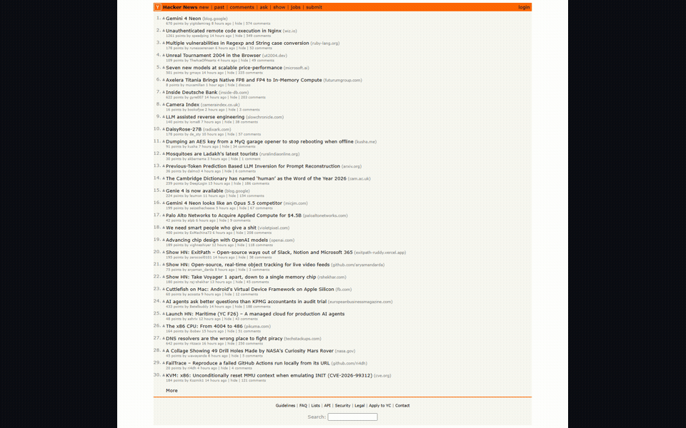
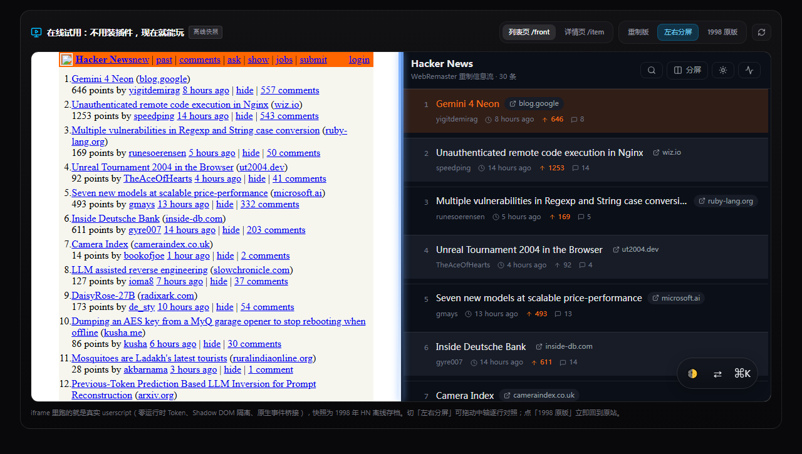

# 🏛️ WebRemaster

**Turn 1998-era websites into modern React interfaces — with zero runtime LLM calls.**

Compile-time inspection · Shadow DOM isolation · Zero-flash boot · Chrome MV3 extension

[](https://github.com/webremaster/webremaster/actions/workflows/ci.yml)
[](https://github.com/webremaster/webremaster)
[](LICENSE)
[](https://www.typescriptlang.org/)
[](https://react.dev/)

[Try it live, no install](https://webremaster.github.io/webremaster/#live-demo) · [Online skin gallery](https://webremaster.github.io/webremaster/) · [Architecture whitepaper](docs/PROJECT_SHOWCASE.md) · [Download extension](https://github.com/webremaster/webremaster/releases)



---

## Why this exists

A lot of the web's most useful content still lives on pages designed in 1998: Hacker News, arXiv, DBLP, university portals, RFC documents, mailing-list archives. The content is irreplaceable. The interface is hostile — fixed-width tables, 12px type, no mobile viewport, no dark mode, no keyboard navigation.

Stylus themes and Tampermonkey scripts have tried to fix this for years, and they keep failing for four structural reasons:

1. **Flash of unstyled content (FOUC).** The ugly page renders first, the theme arrives a second later.
2. **CSS bleed.** Global `table, tr, td` rules from the old site and from your theme fight each other.
3. **Broken origin logic.** Replacing the DOM kills ASP.NET `__VIEWSTATE`, CSRF tokens, and jQuery listeners, so login and forms stop working.
4. **Runtime LLM cost.** Re-generating a page on every visit means seconds of latency and an API bill you cannot sustain.

WebRemaster moves the expensive part to **compile time** and ships a **zero-token runtime**.

---

## How it works

**Compile time** — a Playwright inspector maps the target DOM (skeleton, selectors, form controls, paired rows), writes a declarative contract, generates a React 19 + Tailwind v4 skin, bundles it into a single `.user.js`, and runs six deterministic gates plus a visual review.

**Runtime** — a dependency-free browser SDK handles the parts that are hard to get right:

| Runtime piece | What it solves |
| :--- | :--- |
| Zero-Flash Curtain | Dark overlay from `document-start`; lifts only when the remastered UI is mounted |
| Shadow DOM mount | Physical style isolation, in both directions |
| Hidden Origin | Keeps the original DOM alive for cookies, CSRF and native form submits |
| 4-tier extractor | Selector chain → sibling → spatial heuristic → semantic fallback, with per-field health telemetry |
| TurboNav | Prefetch on hover/touch, partial DOM swap, view transitions, scroll restoration |
| PowerUps | Reader mode, bookmarks, `Cmd+K` palette, Vim keys, CSV/Markdown export, element zapper |
| Split view | Live side-by-side original vs remastered, with a draggable divider |

---

## Try it live, in 30 seconds

The store ships a `#live-demo` section: it loads an offline 1998 Hacker News snapshot into an iframe and injects the compiled `hackernews.user.js` into it — what you see is the real runtime, not a recording.

- **Two routes**: `/front` (feed) and `/item` (thread) snapshots, hitting the feed and thread routes respectively
- **Three states**: Remastered → Split → Original, and the split divider is draggable
- **No install**: pure front-end; no Tampermonkey, no extension, no API key



[🔗 Open the store →](https://webremaster.github.io/webremaster/#live-demo)

---

## Repository layout

```text
packages/
  schema/      # Zod contracts: snapshot, site contract, design spec, verification, manifest
  bridge/      # Zero-dependency runtime SDK (curtain, origin manager, TurboNav, PowerUps)
  ui-kit/      # Component library: shell, feed cards, data table, thread tree, reader layout
  compiler/    # Playwright X-Ray, Vite bundler, six-gate verifier, `wr` CLI
  extension/   # Chrome MV3 extension (badge state, context menu, popup controls)
  store/       # Before/After gallery, deployed to GitHub Pages
skins/         # Compiled skins: source, contract, design, screenshots, gate report, .user.js
configs/       # Site roadmap (top40_sites.yaml)
docs/          # Whitepaper, launch checklist, demo assets
```

---

## Quick start

```bash
git clone https://github.com/webremaster/webremaster.git
cd webremaster
pnpm install
pnpm wr doctor          # checks Node 22, Playwright browsers, skin readiness
pnpm typecheck          # 6 packages, strict
pnpm test               # 154 tests
pnpm build:all
```

Load the extension: open `chrome://extensions/`, enable **Developer mode**, click **Load unpacked**, choose `packages/extension/dist/`, then visit `https://news.ycombinator.com/`.

Try the gallery locally:

```bash
pnpm dev                # http://localhost:5173
```

---

## The `wr` CLI

| Command | What it does |
| :--- | :--- |
| `wr doctor` | Environment health report |
| `wr list` | Roadmap and skin status board |
| `wr inspect <url> --id <siteId>` | DOM X-Ray → `01_snapshot.json` + `before.png` |
| `wr scaffold <siteId>` | Contract, design spec, React entry, styles |
| `wr dev <siteId>` | HMR bridge against the live site |
| `wr build-skin <siteId>` | TypeScript gate + Vite IIFE bundle → `<siteId>.user.js` |
| `wr verify-skin <siteId>` | Live six-gate verification → `after.png` + `05_verification.json` |
| `wr finalize-skin <siteId>` | Final review (gates green + visual score) |
| `wr sync:artifacts` | Push approved skins into the extension and the gallery |

---

## Status

**1 of 40 skins shipped** — Hacker News (`skins/hackernews/`), with a full gate report and before/after/split screenshots.

Next targets: Lobsters, arXiv, V2EX, 阮一峰博客. The full roadmap lives in `configs/top40_sites.yaml`. Open a **Site remaster request** issue and we'll prioritise by 👍.

---

## Contributing

Read [CONTRIBUTING.md](CONTRIBUTING.md) for the six-step skin pipeline and gate rules. Security reports go through [SECURITY.md](SECURITY.md); community expectations are in [CODE_OF_CONDUCT.md](CODE_OF_CONDUCT.md).

## License

MIT — see [LICENSE](LICENSE).
