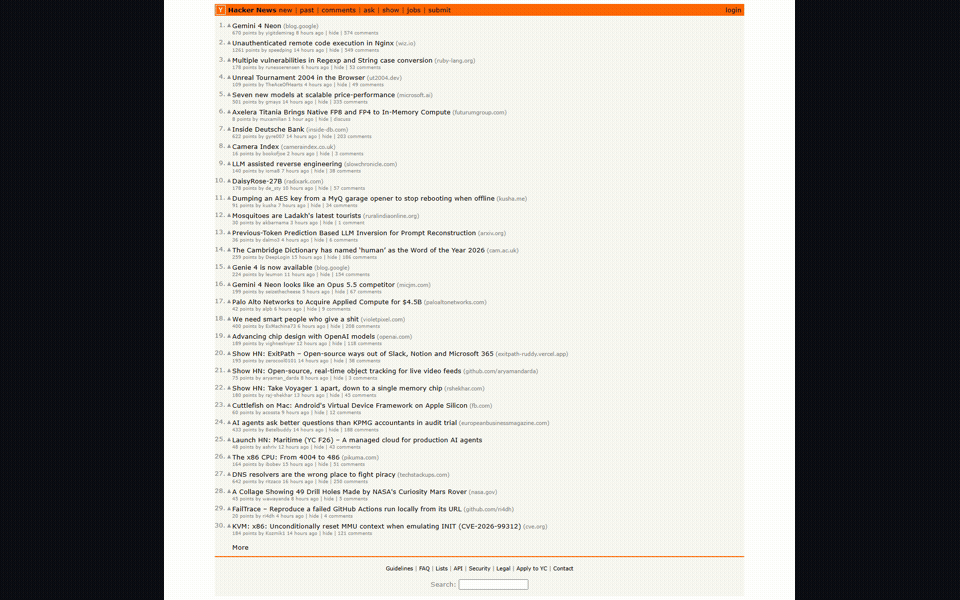
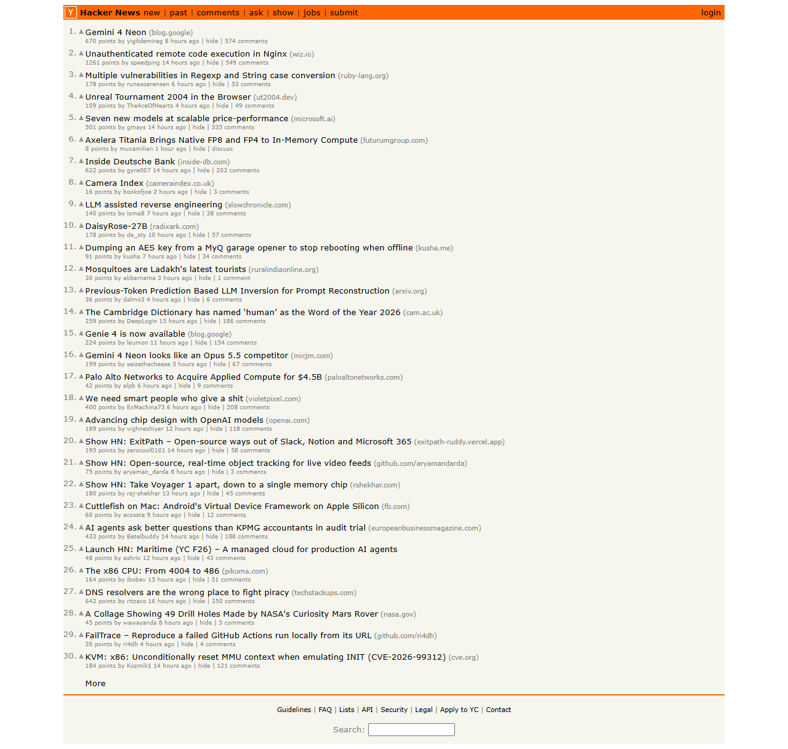
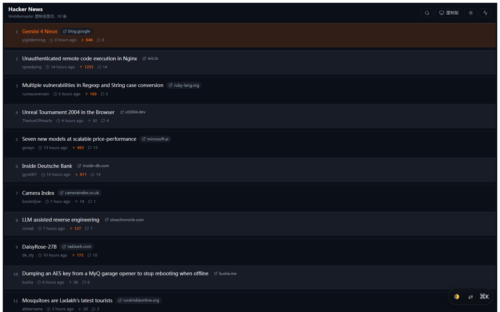
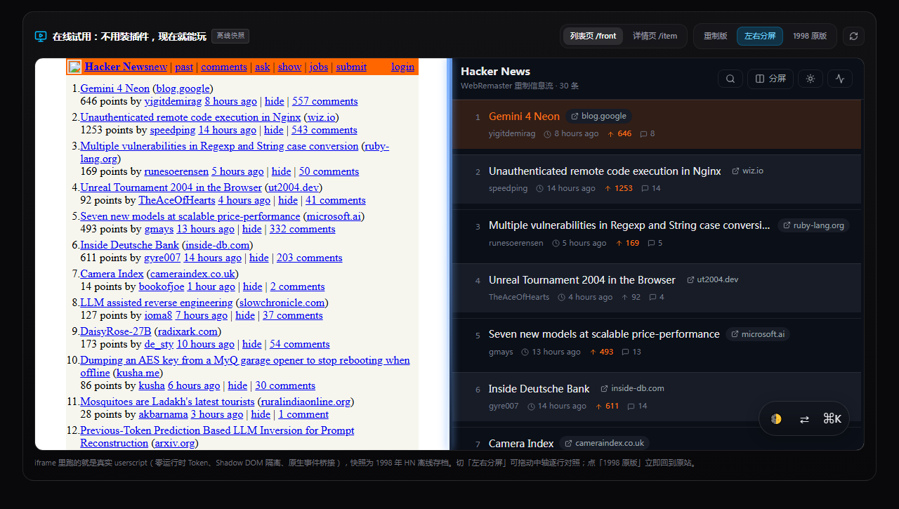
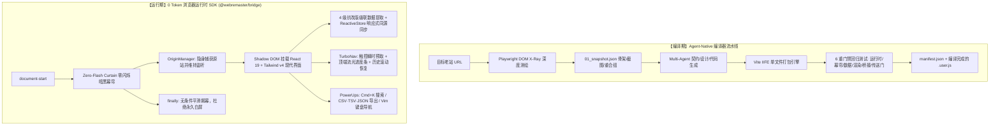
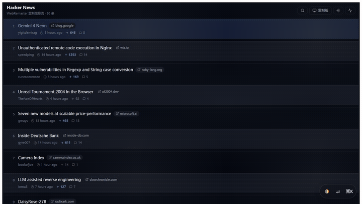

<div align="center">

# 🏛️ WebRemaster

[English](README.en.md) · **简体中文**

**告别 1998 年刺眼、无排版的老旧网站。零 Token 运行时 · Shadow DOM 样式隔离 · React 19 + Tailwind v4 次世代重制编译器。**

[](https://github.com/webremaster/webremaster/actions/workflows/ci.yml)
[](https://github.com/webremaster/webremaster)


[](https://opensource.org/licenses/MIT)
[](https://www.typescriptlang.org/)
[](https://react.dev/)
[](https://tailwindcss.com/)
[](https://playwright.dev/)
[](https://developer.chrome.com/docs/extensions/mv3/)

[**🕹️ 在线试用（免安装）**](https://webremaster.github.io/webremaster/#live-demo) · [**🌐 皮肤商店 & Before/After**](https://webremaster.github.io/webremaster/) · [**📑 项目介绍书与白皮书**](docs/PROJECT_SHOWCASE.md) · [**📦 下载 Chrome 扩展 (.zip)**](https://github.com/webremaster/webremaster/releases) · [**🎯 皮肤路线图（1 / 40 已上架）**](configs/top40_sites.yaml)


---



</div>

## 💡 为什么需要 WebRemaster？

互联网上沉睡着大量极具价值却视觉残破的古典网站：Hacker News、arXiv 论文库、DBLP、高校教务、维基百科以及各类技术文档。

以往给老网站写美化脚本（如 Stylus、Tampermonkey）面临四大痛点：
1. **白屏闪烁（FOUC）**：脚本生效前，刺眼的老版白色页面先闪现 1~2 秒；
2. **样式互相污染**：老网站的全局 `table, tr, td, p` 规则破坏现代组件，反之亦然；
3. **老站表单/事件瘫痪**：单纯重写 DOM 会摧毁 ASP.NET `__VIEWSTATE`、CSRF Token 或 jQuery 事件监听；
4. **运行时大模型昂贵且慢**：如果每次看网页都靠大模型实时翻译/重写，延迟高达数秒且成本不可承受。

**WebRemaster 的解法：编译期 AI 逆向 + 运行期 0 运行时 Token 本地驱动！**

---

## ⚡ 对比：传统美化 vs WebRemaster

| 维度 | 传统 Stylus / 油猴脚本 | 纯 CSS 注入 / Readability | WebRemaster 编译器架构 |
| :--- | :--- | :--- | :--- |
| **首屏体验** | 严重白屏闪烁 (FOUC) | 页面闪烁或丢失交互 | **零闪烁暗黑幕帘 (Zero-Flash Curtain)** · 0ms 视觉过渡 |
| **样式隔离** | 无隔离，极易全局样式击穿 | 极易击穿全局样式 | **Shadow DOM 物理隔离** + Constructible Stylesheets |
| **老站逻辑保全** | 破坏原站监听器、丢失 CSRF | 无法提交表单、无法登录 | **隐身原站 (Hidden Origin)** + 原生 Setter 跨框架事件桥 |
| **路由导航** | 传统 MPA，每点一次全页刷新 | 传统 MPA 刷新 | **TurboNav (MPA 秒变 0ms SPA)** · 触屏与网络感知预取 |
| **数据提取鲁棒性** | 脆弱的单个 class 选择器 | 经常漏正文或误删评论 | **4 级抗改版级联引擎** (选择器链 / 相对定位 / 正则 / 空间邻近) |
| **移动端适配** | 老站固定 980px 桌面微缩视口 | 部分响应式 | **动态 Viewport 自愈注入** + 移动端触摸即时预取 |
| **运行时成本** | 0 成本，但功能极为有限 | 0 成本，功能有限 | **0 Token 纯本地运行**（仅在编译期消耗 Token） |

---

## 📸 Before / After 震撼对比 (Hacker News)

| 1998 原版 (Original) | 2026 WebRemaster 重制版 |
| :---: | :---: |
|  |  |
| 古老 Table 布局 · 刺眼白底 · 缺乏移动端适配 | 高密度暗黑微光 · 等宽数字排版 · TurboNav 0ms 预取 · 折叠评论树 |

---

## 🕹️ 在线试用：30 秒，不用装插件

商店页内置 `#live-demo` 区块：把 1998 年 HN 的离线快照放进 iframe，再把编译好的 `hackernews.user.js` 文本注入进去——访客看到的是真实运行时，不是录屏。

- **双路由**：「列表页 /front」「详情页 /item」两份快照，分别命中 feed 与 thread
- **三态切换**：「重制版 / 左右分屏 / 1998 原版」，分屏模式的分割线可以直接拖动
- **零安装**：纯前端，不需要油猴、扩展或任何 API Key



[🔗 打开商店页 →](https://webremaster.github.io/webremaster/#live-demo)

---

## 🔬 证明它不是"只有一张精修图"：3 分钟生成第二个皮肤

仓库里 `skins/hackernews` 是手工精作的成品，容易被怀疑"编译器只是摆设"。`examples/local-1998/` 是一个 1998 风格的本地静态页，整条链路**不写一行业务代码**：

```bash
node examples/local-1998/server.cjs                                   # 起一个 1998 老站
pnpm wr inspect http://127.0.0.1:4190/ --id demo1998 --out-dir ./skins-tmp
pnpm wr scaffold demo1998 --url http://127.0.0.1:4190/ --skins-dir ./skins-tmp --archetype news-feed
pnpm wr build-skin demo1998 --skins-dir ./skins-tmp
pnpm wr verify-skin demo1998 --no-vlm --skins-dir ./skins-tmp
```

实测结果写在 [`examples/local-1998/05_verification.json`](examples/local-1998/05_verification.json)：**六重门禁 6/6 全绿、数据对齐 100%（20 → 20）、`title` / `url` 两个字段 `tier=1 hits=40 misses=0`**。这份示例同时钉住了 `scaffold` 模板曾经的四个坑（虚构 API、缺 default 导出、选择器带 `html > body` 前缀、CSS 漏扫 ui-kit），任何一处回归都会让这个示例直接红。

---

## 🤖 Agent-Native：把"做一个皮肤"写成 agent 能照做的规程

仓库自带 [`skills/webremaster/SKILL.md`](skills/webremaster/SKILL.md)——不是泛泛的提示词，而是六步可执行规程：DOM 测绘 → 契约与设计 → `entry.tsx` → 打包 → 六门禁 → 终审上架。

- **只写真实 API**：规程逐个点名 `bridge` 里存在的导出（`extractFieldWithCascade`、`createOriginStore`、`HealthTracker`、`TurboNavigator`、`nativeSetInputValue`…），并明确禁止 `queryWithFallback` 这类不存在的导出——这份文档曾经就教错过，现在由人肉 review 与 `scaffold` 断言双重盯着。
- **命令都是真的**：规程里的 `pnpm wr …` 与 CLI `--help` 完全一致；`inspect` / `scaffold` 不需要任何模型 Key。
- **可以先生成再改**：`wr scaffold` 产出的骨架已经能打包、能过门禁，agent 从可运行的代码起步，而不是从空白文件起步。

支持 Skills 的客户端（Claude Code / Cursor / 豆包工作模式等）把 `skills/webremaster/` 作为 Skill 目录加载即可。

---

## 🏗️ 核心架构



---

## 🛠️ Monorepo 模块分布

```text
WebRemaster/
├── packages/
│   ├── schema/        # @webremaster/schema: Zod 共享类型契约 (15 tests)
│   ├── bridge/        # @webremaster/bridge: 零依赖运行时 SDK + 7 大 PowerUps（72 tests）
│   ├── ui-kit/        # @webremaster/ui-kit: 现代组件库 + 容灾保护 + 4 套调色盘（17 tests）
│   ├── compiler/      # @webremaster/compiler: Playwright X-Ray + Vite 打包 + 6 门禁 CLI（48 tests）
│   ├── extension/     # @webremaster/extension: Chrome & Firefox MV3 扩展（徽标联动 / 右键菜单）
│   └── store/         # @webremaster/store: 演示大厅（Before/After 拖拽 + 在线试用 Playground）（2 tests）
├── skins/             # 编译产物库（hackernews 等站点的完整产物与验证报告）
├── examples/          # 端到端回归现场（local-1998：从零生成第二个皮肤并过 6 门禁）
├── configs/           # Top 40 待重制高频老旧网站清单（configs/top40_sites.yaml）
└── release/           # 扩展离线安装包（CI 打 zip 后随 GitHub Release 发布，不入库）
```

---

## 🚀 部署到你自己的 GitHub（一条命令）

仓库里的 badge、在线试用、Release、Pages 与 `repository` 字段都指向占位组织 `webremaster`。换成一个真实账号只要：

```bash
pnpm set-owner <你的 GitHub 用户名>        # 幂等：改完再跑一次也只是再换一次
git remote add origin git@github.com:<你>/webremaster.git
git push -u origin master
git tag v0.1.0 && git push --tags          # 触发 release.yml，产出扩展 zip
```

推送后在仓库 **Settings** 里补四项，仓库卡片才算完整：Description（用 `package.json` 里那句）、Topics（`userscript` / `chrome-extension` / `shadow-dom` / `react`）、Social preview（传 `packages/store/public/og.png`）、Pages 源选 **GitHub Actions**。

---

## ⚡ 快速开始

### 1. 安装与诊断

```bash
# 克隆仓库
git clone https://github.com/webremaster/webremaster.git
cd webremaster

# 安装依赖
pnpm install

# 运行系统诊断（检查 Node 22、Playwright 浏览器、皮肤库就绪度）
pnpm wr doctor
```

### 2. 首次构建、测试与全量打包

> 首次克隆后必须先执行 `pnpm build`：各 workspace 包通过 `dist/` 互相引用类型与代码，跳过后 `typecheck` / `test` 会报找不到 `@webremaster/schema`。

```bash
# 产出 workspace 包的 dist（schema → bridge → ui-kit → compiler）
pnpm build

# 全仓严格类型检查
pnpm typecheck

# 运行 154 项单元测试与门禁自检（6 个包）
pnpm test

# 全栈一键构建（含扩展与皮肤大厅）
pnpm build:all
```

### 3. 安装与体验 Chrome 扩展

1. 浏览器打开 `chrome://extensions/`；
2. 开启右上角 **「开发者模式」**；
3. 点击 **「加载已解压的扩展程序」**，选择目录 `packages/extension/dist/`；
4. 访问 [Hacker News](https://news.ycombinator.com/)，即可见证秒级现代化重制蜕变！

---

## 💻 `wr` CLI 核心指令指南

WebRemaster CLI 采用 Agent-Native 架构设计，提供高可靠的原子化命令：

| 指令 | 作用描述 | 产出物 |
| :--- | :--- | :--- |
| `wr doctor` | 检查 Node.js / Playwright / 皮肤库依赖环境 | 终端彩色健康诊断报告 |
| `wr list` | 查阅 Top 40 矩阵与皮肤编译上架进度 | 终端彩色矩阵进度看板 |
| `wr scaffold <siteId>` | 自动脚手架生成合同、设计、React 19 组件与样式 | `02_contract` / `03_design` / `entry.tsx` |
| `wr dev <siteId>` | 启动实时热重载开发服务器与联调脚本 (HMR) | `<siteId>.dev.user.js` + Vite Dev Server |
| `wr inspect <url> --id <siteId>` | 深度测绘 DOM 结构、表单控件与视口截图 | `01_snapshot.json` + `before.png` |
| `wr build-skin <siteId>` | TypeScript strict + Vite IIFE 单文件打包 | `<siteId>.user.js` |
| `wr verify-skin <siteId>` | 启动真浏览器执行 6 重门禁回归校验（`--fixture` 可离线回放本地快照） | `after.png` + `05_verification.json` |
| `wr finalize-skin <siteId>` | 上架终审（门禁全绿 + VLM ≥ 8.5） | `manifest.json` |
| `wr sync-artifacts` | 将合格皮肤同步至 Chrome 扩展与皮肤大厅 | `skinsRegistry.ts` + `store_index.json` |

---

## ⚡ 现代开箱即用 PowerUps 插件库与主题矩阵

受 GitHub 多个顶尖开源项目启发，WebRemaster 为古老网站注入现代 Web 核心能力：

- 📖 **ReaderMode（借鉴 Mozilla Readability / Safari Reader）**：自动提取正文并剔除导航干扰，智能计算 WPM 预估阅读时间，支持 12~28px 字号缩放与排版调节。
- 🔖 **BookmarkManager（借鉴 Pocket / Readwise）**：客户端本地高隐私稍后阅读书签系统，支持一键导出为标准 Markdown 清单。
- 🛡️ **OriginDefuser & ContentCleaner（借鉴 uBlock Origin / Privacy Badger）**：隐匿原站后自动静音背景音视频并停止跑马灯；移除 Cookie 弹窗并自动解除页面滚动锁死。
- ⚡ **TurboNav（借鉴 Hotwire Turbo / Google Quicklink）**：链接预检与无刷新 DOM 局部替换，结合弱网环境智能节流与平滑进度条。
- ⌨️ **Vim 键盘导航与 CommandPalette**：支持 `j` / `k` 条目移动、`o` 打开、`g` / `G` 顶底跳转，以及 `Cmd+K` 跨功能指令中心；输入标题或作者即可定位到对应卡片（回车跳转 + 高亮）。
- 🎨 **社区顶流主题预设（借鉴 Catppuccin / Tokyo Night / Nord）**：内置 `catppuccin-mocha`、`tokyo-night`、`nord`、`sepia-book` 四套调色盘，`Cmd+K` →「切换配色预设」即可循环切换（localStorage 记住选择），经 CSS 变量与 Shadow DOM 无缝穿透。



---

## 🎯 皮肤路线图：1 / 40 已上架 (`configs/top40_sites.yaml`)

**已上架（含完整门禁报告与 before/after 截图）**：Hacker News → `skins/hackernews/`

其余 39 个站点为规划项（`status: pending`）。想优先看到哪个，欢迎开一个 [`Site remaster request`](.github/ISSUE_TEMPLATE/site_remaster_request.yml) Issue，我们按 👍 数排序。

- **全球开发者生态**：HackerNews（已上架）, Lobsters, PyPI, Go Dev Docs, GNU, Kernel Lore, SQLite, curl, man7, GCC.
- **学术科研与论文**：arXiv CS.AI, arXiv Abs, DBLP, PubMed, OEIS, Wolfram MathWorld, Stanford Plato, Project Gutenberg.
- **标准与协议规范**：RFC 9110, W3C HTML5, Python PEPs, cppreference, PostgreSQL Docs, Git SCM.
- **经典社区与百科**：Wikipedia, Old Reddit, Slashdot, Craigslist, YC Jobs, Internet Archive.
- **中文极客与高校刚需**：V2EX, 阮一峰博客, OI Wiki, 廖雪峰教程, 知网公开检索, 高校正方教务系统靶场.
- **硬核数据与工具门户**：IANA Ports, NIST NVD, Unicode Charts, FFmpeg Docs.

---

## 🤝 参与贡献

欢迎为全球任何你看不顺眼的古老网站编写 Remaster 皮肤！请查阅 [Contributing Guide](CONTRIBUTING.md) 了解代码规范与门禁准则。

## 📜 开源协议

本项目采用 MIT 协议开源。

