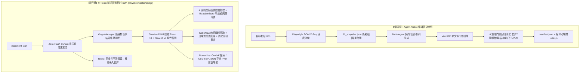

<div align="center">

# 🏛️ WebRemaster

**告别 1998 年刺眼、无排版的老旧网站。零 Token 运行时 · Shadow DOM 样式隔离 · React 19 + Tailwind v4 次世代重制编译器。**

[](https://github.com/webremaster/webremaster/actions/workflows/ci.yml)
[](https://github.com/webremaster/webremaster)
[](https://opensource.org/licenses/MIT)
[](https://www.typescriptlang.org/)
[](https://react.dev/)
[](https://tailwindcss.com/)
[](https://playwright.dev/)
[](https://developer.chrome.com/docs/extensions/mv3/)

[**🌐 在线皮肤商店 & Before/After 演示**](https://webremaster.github.io/webremaster/) · [**📦 下载 Chrome 扩展 (.zip)**](https://github.com/webremaster/webremaster/releases) · [**📖 架构设计白皮书**](#-核心架构) · [**🎯 Top 40 站点清单**](#-top-40-待重制网站矩阵)

---

</div>

## 💡 为什么需要 WebRemaster？

互联网上沉睡着大量极具价值却视觉残破的古典网站：Hacker News、arXiv 论文库、DBLP、高校教务、维基百科以及各类技术文档。

以往给老网站写美化脚本（如 Stylus、Tampermonkey）面临四大痛点：
1. **白屏闪烁（FOUC）**：脚本生效前，刺眼的老版白色页面先闪现 1~2 秒；
2. **样式互相污染**：老网站的全局 `table, tr, td, p` 规则破坏现代组件，反之亦然；
3. **老站表单/事件瘫痪**：单纯重写 DOM 会摧毁 ASP.NET `__VIEWSTATE`、CSRF Token 或 jQuery 事件监听；
4. **运行时大模型昂贵且慢**：如果每次看网页都靠大模型实时翻译/重写，延迟高达数秒且成本不可承受。

**WebRemaster 的解法：编译期 AI 逆向 + 运行期 0 运行时 Token 本地驱动！**

---

## ⚡ 对比：传统美化 vs WebRemaster

| 维度 | 传统 Stylus / 油猴脚本 | 纯 CSS 注入 / Readability | WebRemaster 编译器架构 |
| :--- | :--- | :--- | :--- |
| **首屏体验** | 严重白屏闪烁 (FOUC) | 页面闪烁或丢失交互 | **零闪烁暗黑幕帘 (Zero-Flash Curtain)** · 0ms 视觉过渡 |
| **样式隔离** | 无隔离，极易全局样式击穿 | 极易击穿全局样式 | **Shadow DOM 物理隔离** + Constructible Stylesheets |
| **老站逻辑保全** | 破坏原站监听器、丢失 CSRF | 无法提交表单、无法登录 | **隐身原站 (Hidden Origin)** + 原生 Setter 跨框架事件桥 |
| **路由导航** | 传统 MPA，每点一次全页刷新 | 传统 MPA 刷新 | **TurboNav (MPA 秒变 0ms SPA)** · 触屏与网络感知预取 |
| **数据提取鲁棒性** | 脆弱的单个 class 选择器 | 经常漏正文或误删评论 | **4 级抗改版级联引擎** (选择器链 / 相对定位 / 正则 / 空间邻近) |
| **移动端适配** | 老站固定 980px 桌面微缩视口 | 部分响应式 | **动态 Viewport 自愈注入** + 移动端触摸即时预取 |
| **运行时成本** | 0 成本，但功能极为有限 | 0 成本，功能有限 | **0 Token 纯本地运行**（仅在编译期消耗 Token） |

---

## 📸 Before / After 震撼对比 (Hacker News)

| 1998 原版 (Original) | 2026 WebRemaster 重制版 |
| :---: | :---: |
|  |  |
| 古老 Table 布局 · 刺眼白底 · 缺乏移动端适配 | 高密度暗黑微光 · 等宽数字排版 · TurboNav 0ms 预取 · 折叠评论树 |

---

## 🏗️ 核心架构



---

## 🛠️ Monorepo 模块分布

```text
WebRemaster/
├── packages/
│   ├── schema/        # @webremaster/schema: Zod 共享类型契约 (15 tests)
│   ├── bridge/        # @webremaster/bridge: 零依赖浏览器运行时 SDK + PowerUps (51 tests)
│   ├── ui-kit/        # @webremaster/ui-kit: Linear 级现代组件库 (9 tests)
│   ├── compiler/      # @webremaster/compiler: Playwright X-Ray + Vite 打包 + 6 门禁 CLI (39 tests)
│   ├── extension/     # @webremaster/extension: Chrome & Firefox MV3 扩展 (徽标联动 / 右键菜单)
│   └── store/         # @webremaster/store: GitHub Pages 演示大厅 (Before/After 拖拽对比) (2 tests)
├── skins/             # 编译产物库 (包含 hackernews 等站点的完整编译产物)
├── configs/           # Top 40 待重制高频老旧网站清单 (configs/top40_sites.yaml)
└── release/           # 开箱即用的 Chrome 扩展离线安装包 (webremaster-chrome-ext.zip)
```

---

## ⚡ 快速开始

### 1. 安装与诊断

```bash
# 克隆仓库
git clone https://github.com/webremaster/webremaster.git
cd webremaster

# 安装依赖
pnpm install

# 运行系统诊断（检查 Node 22、Playwright 浏览器、皮肤库就绪度）
pnpm wr doctor
```

### 2. 运行全量测试与构建

```bash
# 全仓严格类型检查
pnpm typecheck

# 运行 117 项全量单元测试与门禁自检（100% 绿灯）
pnpm test

# 全栈一键构建
pnpm build:all
```

### 3. 安装与体验 Chrome 扩展

1. 浏览器打开 `chrome://extensions/`；
2. 开启右上角 **「开发者模式」**；
3. 点击 **「加载已解压的扩展程序」**，选择目录 `packages/extension/dist/`；
4. 访问 [Hacker News](https://news.ycombinator.com/)，即可见证秒级现代化重制蜕变！

---

## 💻 `wr` CLI 核心指令指南

WebRemaster CLI 采用 Agent-Native 架构设计，提供高可靠的原子化命令：

| 指令 | 作用描述 | 产出物 |
| :--- | :--- | :--- |
| `wr doctor` | 检查 Node.js / Playwright / 皮肤库依赖环境 | 终端彩色健康诊断报告 |
| `wr inspect <url> --id <siteId>` | 深度测绘 DOM 结构、表单控件与视口截图 | `01_snapshot.json` + `before.png` |
| `wr build-skin <siteId>` | TypeScript strict + Vite IIFE 单文件打包 | `<siteId>.user.js` |
| `wr verify-skin <siteId>` | 启动真浏览器执行 6 重门禁回归校验 | `after.png` + `05_verification.json` |
| `wr finalize-skin <siteId>` | 上架终审（门禁全绿 + VLM ≥ 8.5） | `manifest.json` |
| `wr sync-artifacts` | 将合格皮肤同步至 Chrome 扩展与皮肤大厅 | `skinsRegistry.ts` + `store_index.json` |

---

## 🎯 Top 40 待重制网站矩阵 (`configs/top40_sites.yaml`)

- **全球开发者生态**：HackerNews（已上架）, Lobsters, PyPI, Go Dev Docs, GNU, Kernel Lore, SQLite, curl, man7, GCC.
- **学术科研与论文**：arXiv CS.AI, arXiv Abs, DBLP, PubMed, OEIS, Wolfram MathWorld, Stanford Plato, Project Gutenberg.
- **标准与协议规范**：RFC 9110, W3C HTML5, Python PEPs, cppreference, PostgreSQL Docs, Git SCM.
- **经典社区与百科**：Wikipedia, Old Reddit, Slashdot, Craigslist, YC Jobs, Internet Archive.
- **中文极客与高校刚需**：V2EX, 阮一峰博客, OI Wiki, 廖雪峰教程, 知网公开检索, 高校正方教务系统靶场.
- **硬核数据与工具门户**：IANA Ports, NIST NVD, Unicode Charts, FFmpeg Docs.

---

## 🤝 参与贡献

欢迎为全球任何你看不顺眼的古老网站编写 Remaster 皮肤！请查阅 [Contributing Guide](CONTRIBUTING.md) 了解代码规范与门禁准则。

## 📜 开源协议

本项目采用 [MIT License](LICENSE) 协议开源。
